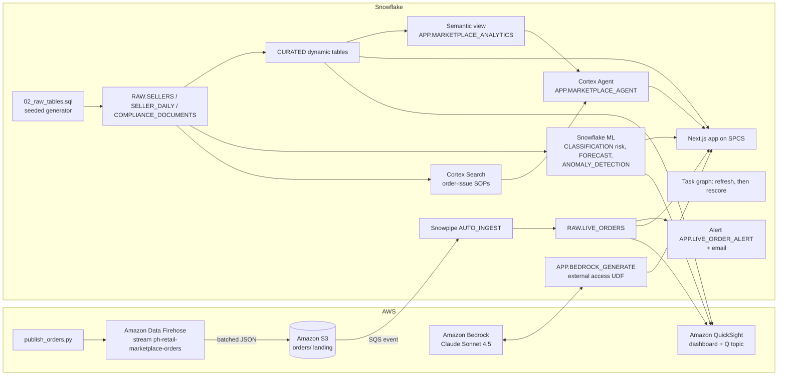

# Philippines Online Marketplace - Seller Health and Order Integrity

Seller health monitoring for **48 fictional sellers on a fictional Philippine online marketplace**, shipping from five real cities used as regions (Quezon City, Cebu City, Davao City, Iloilo City, Cagayan de Oro). Snowflake, optionally with AWS, takes the trust team from a live order issue to a 7-day order-cancellation risk score per seller, an alert email and an AI action memo.

## Architecture

The pipeline runs on **Snowflake** (Dynamic Tables, Snowflake ML, Cortex Search, Cortex Agent, Cortex AI_COMPLETE, SPCS) and, in the full build, also uses **AWS** (Amazon Data Firehose, S3, Bedrock Claude, QuickSight + Amazon Q). Order events arrive in `RAW.LIVE_ORDERS`. Dynamic tables roll 90 days of seller-day rows into orders processed, GMV in PHP, order issues, cancelled orders, late deliveries, clean order rate and stock sync compliance. Snowflake ML predicts which sellers are likely to have a cancelled order in the next 7 days, forecasts order issues across the marketplace and flags unusual return rates. A Cortex Agent answers with SQL and SOP citations, and an LLM drafts the trust team's action memo.

Interactive diagrams (hover for object names): [Snowflake only](docs/architecture-snowflake.html) | [AWS + Snowflake](docs/architecture-aws.html). The app's Architecture & Data tab shows both, the current build first. Regenerate them with `python3 docs/build_architecture.py`.



In the Snowflake-only build there is no AWS subgraph: `APP.SIMULATE_ORDERS` writes to `RAW.LIVE_ORDERS`, and the app calls Cortex `AI_COMPLETE` in place of the Bedrock UDF.

## Snowflake Capabilities

| Capability | Implementation |
|-----------|---------------|
| Dynamic Tables | `CURATED.KPI_SUMMARY`, `PERFORMANCE_SUMMARY`, `ISSUE_SUMMARY`, `TREND_ANALYSIS`, built from the RAW tables |
| Snowflake ML | CLASSIFICATION of 7-day order-cancellation risk (`ML.CANCEL_RISK_SCORES`), a 14-day order-issue FORECAST, and return rate ANOMALY_DETECTION |
| Cortex Search | 14 synthetic order-issue SOPs (one per product category and issue type) in `SEARCH.ISSUE_SOP_SEARCH` |
| Semantic View | `APP.MARKETPLACE_ANALYTICS` over sellers, issue types, daily totals and risk |
| Cortex Agent | `APP.MARKETPLACE_AGENT`: Cortex Analyst over the semantic view, plus Cortex Search for SOP citations |
| Cortex AI | `AI_COMPLETE('claude-sonnet-4-5')` for grounded answers, and for the action memo in the Snowflake-only build |
| Alerts + Tasks | `APP.LIVE_ORDER_ALERT` logs ISSUE events and sends email; task graph `TASK_REFRESH_CURATED`, then `TASK_RESCORE_RISK` |
| Snowpark Container Services | Next.js app `APP.PH_RETAIL_MARKETPLACE_APP` with 6 tabs: Executive Cockpit, Predictive, Controls, Live Orders, Ask AI, Architecture & Data |
| Snowpipe | `RAW.LIVE_ORDERS_PIPE` AUTO_INGEST from S3 (AWS build only) |

## AWS Services

These run only in the AWS + Snowflake build.

| Service | Role in Demo |
|---------|-------------|
| Amazon Data Firehose | Direct PUT stream `ph-retail-marketplace-orders` takes simulated order events and writes them to S3 in batches |
| Amazon S3 | Landing bucket (`orders/`); an event notification goes to the Snowpipe SQS queue |
| Amazon Bedrock | Claude Sonnet 4.5 drafts the action memo, called from Snowflake through an external-access UDF |
| Amazon QuickSight | DIRECT_QUERY seller health dashboard over Snowflake (daily order issues, cancelled orders by seller, order-cancellation risk) |
| Amazon Q | Natural-language questions over the QuickSight topic `ph-retail-marketplace-topic` |
| AWS IAM | Least-privilege roles for S3, Firehose and Bedrock |

## Personas

Both personas are fictional.

| Persona | Role | Key Questions |
|---------|------|---------------|
| **Andrea Villanueva** | Head of Marketplace Trust and Operations | "How many orders reach buyers without an issue?" "Which issue types end in a cancellation most often?" |
| **Paolo Mendoza** | Seller Health Analyst | "Which sellers need a health review this week, and what does the SOP say to do?" |

## Data

Every table is synthetic and HASH-seeded, so a rebuild reproduces it. The marketplace, its sellers and all names are fictional; the five cities are real Philippine cities used only as regions.

| Table | Rows | Description |
|-------|------|-------------|
| RAW.SELLERS | 48 | Sellers in 5 Philippine cities and 5 categories (Fashion, Electronics, Home and living, Health and beauty, Groceries), with a fulfilment risk tier |
| RAW.SELLER_DAILY | 4,320 | One row per seller per day for 90 days: orders, GMV (PHP), order issues, cancelled orders, late deliveries, issue type, stock syncs, return rate and time to dispatch |
| RAW.COMPLIANCE_DOCUMENTS | 48 | Required, on-file and pending seller documents per seller |
| SEARCH.ISSUE_DOCS | 14 | Synthetic order-issue SOPs indexed for Cortex Search |
| RAW.LIVE_ORDERS | Grows during the demo | Live order events from Firehose (AWS build) or `APP.SIMULATE_ORDERS` (Snowflake-only build) |
| ML.CANCEL_RISK_SCORES | 48 | 7-day order-cancellation probability and risk band per seller |

## Build Instructions

### Prerequisites
- Snowflake account with ACCOUNTADMIN access, and Cortex AI enabled (AI_COMPLETE, Search, Agent).
- An X-Small warehouse with auto-suspend at or below 120 s, and an existing SPCS compute pool.
- Python 3.11+, `snowflake-connector-python`, Node.js 22+, Docker and the `snow` CLI.
- App image: run `snow spcs image-registry login`, then build and push `ph-retail-marketplace-app:v1` to the database's `APP.IMAGES` repository (see the header of `snowflake/07_deploy_app.sql`).
- AWS build only: `boto3`, AWS credentials for the target account (us-west-2) with Bedrock access, and QuickSight Enterprise.

### SPCS App
```
<DATABASE>.APP.PH_RETAIL_MARKETPLACE_APP
```

### Tests
```bash
python -m pytest aws snowflake quicksight
```

For a local run, put `SNOWFLAKE_ACCOUNT`, `SNOWFLAKE_USER`, `SNOWFLAKE_DATABASE`, `SNOWFLAKE_WAREHOUSE`, `SNOWFLAKE_AUTHENTICATOR=PROGRAMMATIC_ACCESS_TOKEN`, `SNOWFLAKE_TOKEN` and `DEMO_PLATFORM` in the environment, then run `npm --prefix app run build && npm --prefix app start`.

## Build Modes

The two modes run on one shared core and differ in three layers. The `DEMO_PLATFORM` value in the app SPCS spec selects the memo provider and the Live Orders copy.

| Layer | Snowflake Only | Full AWS + Snowflake |
|---|---|---|
| Live orders | `CALL APP.SIMULATE_ORDERS(n)` inserts simulated order events into `RAW.LIVE_ORDERS`. This simulates an order feed; it is not Snowpipe Streaming | `aws/publish_orders.py` to Amazon Data Firehose, then S3, SQS and Snowpipe AUTO_INGEST |
| Action memo | Cortex `AI_COMPLETE('claude-sonnet-4-5')` | Amazon Bedrock Claude Sonnet 4.5 through `APP.BEDROCK_GENERATE` |
| BI and natural-language questions | The SPCS app is the dashboard; questions go to the Cortex Agent | Also a QuickSight dashboard and an Amazon Q topic |
| App setting | `DEMO_PLATFORM: snowflake` | `DEMO_PLATFORM: aws` |

### Snowflake Only

```bash
# 1. Core data and dynamic tables (guarded: new isolated database only)
python snowflake/run_core.py --database PHILIPPINES_RETAIL_MARKETPLACE_SNOWFLAKE --warehouse <XS_WAREHOUSE> --connection <CONNECTION> --apply
# 2. Native order feed, ML, search, semantic view, agent, alert and task graph
python snowflake/run_intelligence.py --database PHILIPPINES_RETAIL_MARKETPLACE_SNOWFLAKE --platform snowflake --warehouse <XS_WAREHOUSE> --connection <CONNECTION> --alert-email you@example.com
# 3. App on SPCS with DEMO_PLATFORM=snowflake (push the image first)
python snowflake/run_intelligence.py --database PHILIPPINES_RETAIL_MARKETPLACE_SNOWFLAKE --platform snowflake --warehouse <XS_WAREHOUSE> --connection <CONNECTION> --alert-email you@example.com --files 07_deploy_app.sql --compute-pool <COMPUTE_POOL>
```

During the demo:
- Run `CALL APP.SIMULATE_ORDERS(20)` to add live order events. For a continuous feed, run `ALTER TASK APP.TASK_SIMULATE_ORDERS RESUME`, and `SUSPEND` it afterwards.
- Run `EXECUTE ALERT APP.LIVE_ORDER_ALERT` to raise the alert email.
- Run `EXECUTE TASK APP.TASK_REFRESH_CURATED` to refresh the curated tables and rescore risk.

Afterwards, drop the database or run `ALTER SERVICE APP.PH_RETAIL_MARKETPLACE_APP SUSPEND`.

### Full AWS + Snowflake

```bash
# 1. Core data and dynamic tables (guarded: new isolated database only)
python snowflake/run_core.py --database PHILIPPINES_RETAIL_MARKETPLACE_AWS --warehouse <XS_WAREHOUSE> --connection <CONNECTION> --apply
# 2. AWS ingestion and Bedrock (dry run first, then --apply)
python aws/setup_aws.py --database PHILIPPINES_RETAIL_MARKETPLACE_AWS --account <AWS_ACCOUNT_ID> --connection <CONNECTION> --apply
# 3. ML, search, semantic view, agent, alert and task graph
python snowflake/run_intelligence.py --database PHILIPPINES_RETAIL_MARKETPLACE_AWS --platform aws --warehouse <XS_WAREHOUSE> --connection <CONNECTION> --alert-email you@example.com
# 4. App on SPCS with DEMO_PLATFORM=aws (push the image first)
python snowflake/run_intelligence.py --database PHILIPPINES_RETAIL_MARKETPLACE_AWS --platform aws --warehouse <XS_WAREHOUSE> --connection <CONNECTION> --alert-email you@example.com --files 07_deploy_app.sql --compute-pool <COMPUTE_POOL>
# 5. QuickSight dashboard and Q topic (needs an existing Snowflake data source)
python quicksight/build_dashboards.py --database PHILIPPINES_RETAIL_MARKETPLACE_AWS --account <AWS_ACCOUNT_ID> --principal-arn <QUICKSIGHT_USER_ARN> --data-source-arn <DATA_SOURCE_ARN> --prefix ph-retail-marketplace --apply --update --with-topic
```

QuickSight objects must be shared with the QuickSight user who signs in (`--principal-arn`); otherwise the console shows nothing.

During the demo:
- Run `python aws/publish_orders.py --count 20` to send live order events. Firehose buffers for up to 60 seconds before writing to S3.
- Run `EXECUTE ALERT APP.LIVE_ORDER_ALERT` to raise the alert email.
- Run `EXECUTE TASK APP.TASK_REFRESH_CURATED` to refresh the curated tables and rescore risk.


When you are done, `python aws/teardown_aws.py --database PHILIPPINES_RETAIL_MARKETPLACE_AWS --account <AWS_ACCOUNT_ID> --connection <CONNECTION> --apply` deletes the AWS resources plus the account-level Bedrock external-access and S3 storage integrations. The email integration `PH_RETAIL_MARKETPLACE_EMAIL_INT` stays, because the Snowflake-only build uses it too.

## Business Impact

Industry research and a Snowflake customer outcome:
- **Philippine digital growth is led by e-commerce**: "Philippines continues its double-digit growth across all core sectors, driven by e-commerce" -- [Google, Temasek and Bain & Company, e-Conomy SEA 2024 report](https://services.google.com/fh/files/misc/e_conomy_sea_2024_report.pdf)
- **Video commerce is reshaping Southeast Asian e-commerce**: "E-commerce growth surges to +15% year-on-year, propelled by video commerce – which now accounts for 20% of e-commerce GMV, up from less than 5% in 2022" -- [Google, Temasek and Bain & Company, e-Conomy SEA 2024 report](https://services.google.com/fh/files/misc/e_conomy_sea_2024_report.pdf)
- **Petco** (Snowflake customer) "now processes data up to 50% faster with Snowflake", and Snowflake's architecture sped up "multiple jobs like sales loads and Salesforce marketing data loads by 25-50%" -- [Snowflake customer story: Petco](https://www.snowflake.com/en/customers/all-customers/case-study/petco/)

## Key Demo Numbers

All figures are synthetic and come from the seeded demo data. Forecast and anomaly figures can shift slightly with the build day.

- **48 sellers** in 5 Philippine cities and 5 categories, 4,320 seller-days over 90 days: **807,700 orders** worth PHP 1.78 B GMV
- **Clean order rate 99.90%**: **819 order issues**, of which **279** ended as cancelled orders (issue cancellation rate 34.1%), and **122 late deliveries**
- **Item not as described** causes the most cancelled orders (78 of 213 issues); the 20 weather-related courier disruption issues (Cebu City and Davao City) were all resolved without a cancellation
- Sellers shipping from **Iloilo City** have the most cancelled orders (69); Cagayan de Oro has the fewest (41)
- **Order-cancellation model**, out-of-time holdout: precision 0.56 and recall 0.61 at a 0.5 threshold, against a 0.28 base rate. 15 sellers are high risk; the top one, SLR-0046, scores 97.4%
- **14-day order-issue forecast** with prediction intervals; **46 of 768** recent seller-days flagged as return rate anomalies
- **Stock sync compliance 73.6%**; seller document coverage 50.4%, with 27 documents pending
- **14 SOPs** indexed in Cortex Search and cited by ID in agent answers

## License

Apache 2.0 — See [LICENSE](LICENSE) for details.

This is a personal demo project and is not an official Snowflake offering. It comes with no support or warranty. Industry metrics cited are from publicly available third-party research and Snowflake customer stories; they represent reported outcomes and are not guarantees of results.
